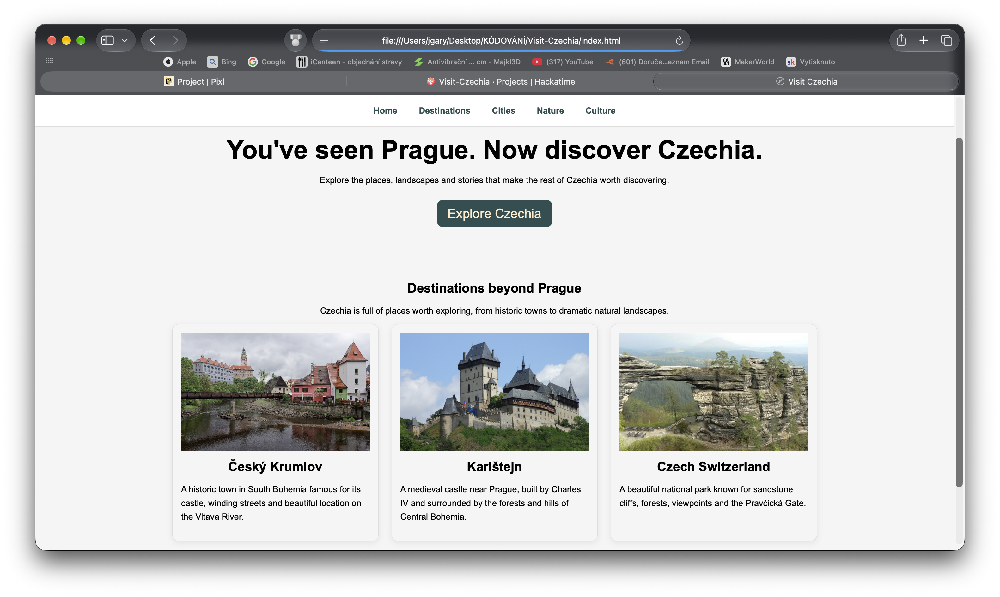
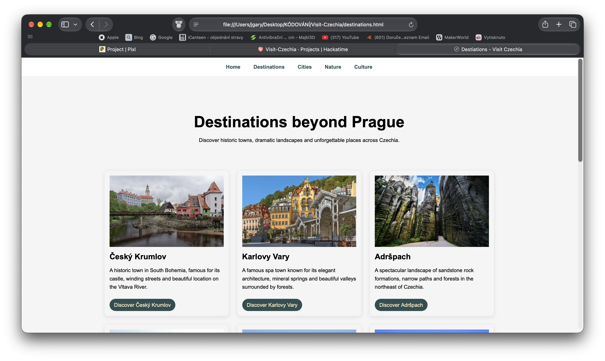
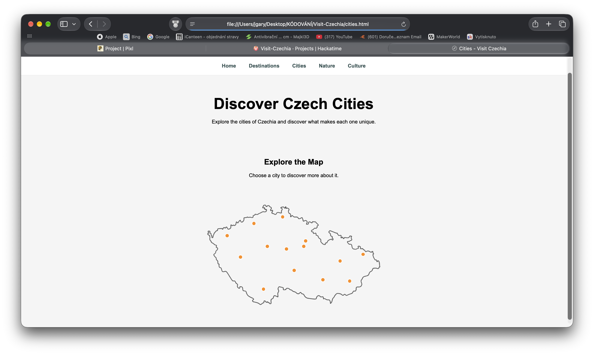
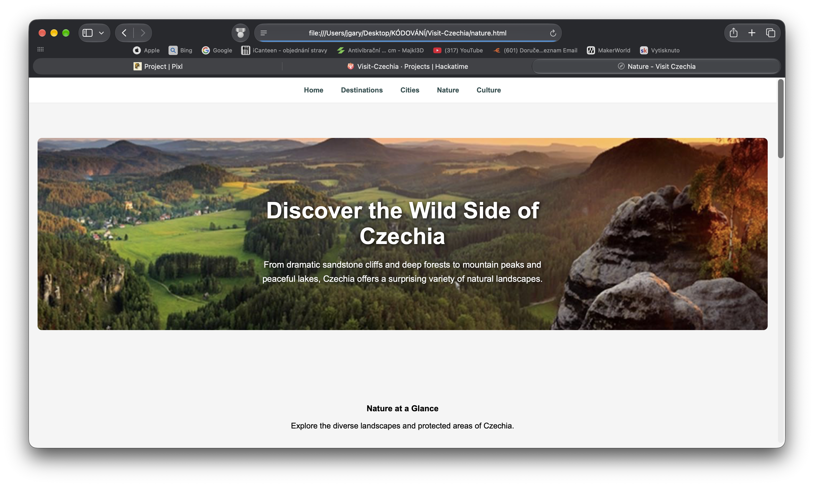
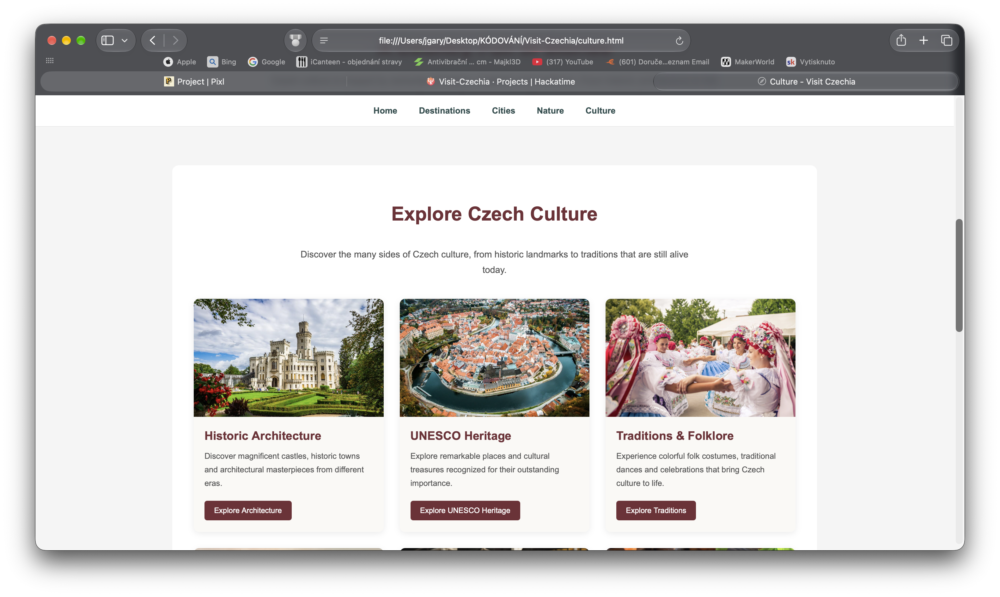

# Visit-Czechia 🇨🇿
A travel website showcasing places to discover in Czechia beyond Prague.

Visit-Czechia is a travel website created to introduce visitors to the diversity of the Czech Republic beyond its capital city. It highlights interesting destinations, historic towns, natural landscapes and cultural attractions across the country.

The goal is to inspire people to explore lesser-known places, discover Czech history and culture, and see how much more Czechia has to offer.

## 🌍 About the Project

Prague is often the first destination people think of when visiting the Czech Republic. However, the country has many other remarkable places worth exploring.

Visit-Czechia was created to showcase these destinations in one accessible and visually appealing website.

The project presents different regions of Czechia through dedicated pages containing descriptions, photographs, interesting places and useful information.

The website was designed and developed as an independent project, with a focus on learning web development and creating something useful for people interested in travelling around Czechia.

## ✨ Website Sections

The website is divided into five main sections:

### 1. Home

The homepage introduces Visit-Czechia and its main idea:

* Discover destinations beyond Prague.
* Explore selected places across the country.
* Find inspiration for visiting Czech cities, natural areas and cultural landmarks.

It also provides an overview of the website and links to its main sections.



### 2. Destinations

This section introduces selected destinations across Czechia.

It features places such as:

* Český Krumlov
* Karlovy Vary
* Adršpach
* Czech Switzerland
* Pálava
* Karlštejn
* Kutná Hora

Each destination has its own dedicated page with information about the area, notable landmarks and places worth visiting.



### 3. Cities

The Cities section showcases Czech towns and cities, highlighting their history, architecture, landmarks and local character.

Dedicated city pages include information about places such as:

* Brno
* České Budějovice
* Hradec Králové
* Jihlava
* Karlovy Vary
* Liberec
* Olomouc
* Ostrava
* Pardubice
* Pilsen
* Ústí nad Labem
* Zlín

The pages provide an introduction to each city, key facts and descriptions of selected attractions.



### 4. Nature

This section focuses on Czechia's natural landscapes, national parks and outdoor destinations.

It introduces four national parks:

* Krkonoše National Park
* Czech Switzerland National Park
* Šumava National Park
* Podyjí National Park

Dedicated pages showcase their landscapes, interesting natural features, viewpoints and opportunities for outdoor activities.



### 5. Culture

The Culture section explores Czech history, traditions, architecture and creative heritage.

It contains six dedicated topics:

* **Historic Architecture** – important architectural styles and historic buildings.
* **UNESCO Heritage** – places in Czechia recognized for their cultural or natural significance.
* **Traditions & Folklore** – Czech customs, celebrations and traditional events.
* **Arts, Music & Theatre** – Czech artistic heritage and cultural life.
* **Czech Crafts & Design** – traditional craftsmanship and modern design.
* **Czech Food & Cuisine** – traditional Czech dishes and culinary specialties.

Together, these pages provide an introduction to the cultural identity of the Czech Republic.



---

## 🛠️ Technologies Used

The website was built using fundamental web technologies:

* **HTML** – page structure and content.
* **CSS** – styling, layout, visual design and responsive behavior.

No frontend frameworks or complex build tools are required.

## 📱 Design & Features

The website was designed to be straightforward to navigate and easy to explore.

Its main features include:

* Multiple dedicated pages for destinations, cities, nature and culture.
* Consistent navigation across the website.
* Dedicated content sections for individual places and topics.
* Photographs illustrating destinations and attractions.
* Responsive layouts adapted for smaller screens.
* CSS-based layouts using Flexbox and Grid.
* Image positioning and cropping to create consistent visual presentation.
* Descriptive alternative text for images.
* A consistent visual style throughout the website.

The project focuses on presenting information in a clear and accessible way rather than overwhelming visitors with unnecessary features.


## 📂 Project Structure

The project consists of HTML pages, a shared stylesheet and an images directory.

```text
Visit-Czechia/
│
├── index.html
├── destinations.html
├── cities.html
├── nature.html
├── culture.html
│
├── [individual destination pages]
├── [individual city pages]
├── [individual nature pages]
├── [individual culture pages]
│
├── style.css
│
└── images/
    └── [website photographs]
```

The individual HTML pages contain the content for each section, while `style.css` provides shared styling across the website.

## 🎯 Project Goals & Learning Experience

Visit-Czechia was developed as a learning project with several goals:

* Improve practical HTML and CSS skills.
* Learn how to structure a multi-page website.
* Understand how to create consistent layouts across different pages.
* Work with images, typography, Flexbox and CSS Grid.
* Improve responsive web design skills.
* Organize content into clear and accessible sections.
* Build and complete a real project from the initial idea to a finished website.

Throughout development, the project evolved from a simple travel website concept into a larger multi-page presentation of Czech destinations, cities, nature and culture.


## 👤 Author

Created by **Jan Garhofr**, a student and beginner web developer from the Czech Republic.

GitHub: [@jgary133](https://github.com/jgary133)

---

**Visit-Czechia – Discover more than Prague. 🇨🇿**
